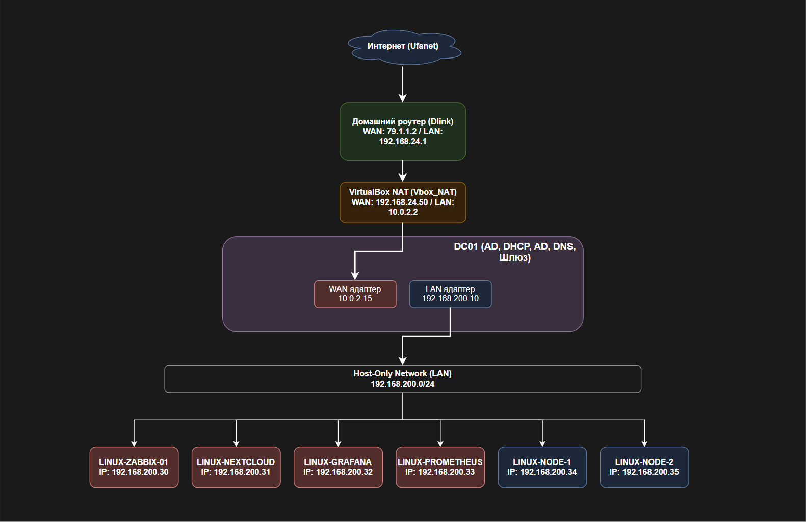

# Full Infrastructure Lab (Домашняя лаборатория на базе VirtualBox)

Добро пожаловать в главный репозиторий, описывающий полную архитектуру моей изолированной лабораторной среды. 

Этот проект представляет собой симуляцию корпоративной инфраструктуры, развернутую на домашнем ПК с помощью VirtualBox. В лабе реализованы: маршрутизация, Active Directory, собственные DNS и DHCP серверы, веб-сервисы (Nextcloud), а также полноценный стек мониторинга (Zabbix, Prometheus, Grafana).

Данный репозиторий является **"родительским"**. Здесь описана общая логика работы, топология сети и порядок развертывания. Детальные инструкции по настройке каждой отдельной виртуальной машины (ноды) вынесены в соответствующие дочерние репозитории.



## Архитектура и топология

Стенд построен по классической трехуровневой схеме:
1. **Внешний контур:** Выход в интернет через домашний роутер (Dlink) и NAT VirtualBox.
2. **Ядро (Шлюз и Инфраструктура):** **Windows Server (DC01)**. Выполняет роль маршрутизатора (RRAS/NAT), контроллера домена (AD), а также раздает IP (DHCP) и резолвит имена (DNS) для внутренней сети.
3. **Изолированная LAN (`192.168.200.0/24`):** Внутренняя сеть (Host-Only Adapter), в которой работают все Linux-серверы (клиенты домена).

### План адресации и инвентарь нод

| Хостнейм | IP-адрес | ОС | Роль / Сервисы | Ссылка на репозиторий |
| :--- | :--- | :--- | :--- | :--- |
| **DC01** | 10.0.2.15 (WAN)<br>192.168.200.10 (LAN) | Windows Server | Шлюз (NAT), Active Directory, DNS, DHCP | 👉 [windows-infra-lab](https://github.com/mikheev-ka/windows-infra-lab) |
| **LINUX-ZABBIX-01** | 192.168.200.30 | Ubuntu 24.04 | Сервер мониторинга Zabbix, PostgreSQL | 👉 [zabbix-ubuntu](https://github.com/mikheev-ka/zabbix-ubuntu) |
| **LINUX-NEXTCLOUD** | 192.168.200.31 | Ubuntu 24.04 | Облачное хранилище (LEMP + SSL) | 👉 [nextcloud-lemp](https://github.com/mikheev-ka/nextcloud-lemp) |
| **LINUX-GRAFANA** | 192.168.200.32 | Ubuntu 24.04 | Визуализация метрик Prometheus | 👉 [monitoring-stack](https://github.com/mikheev-ka/monitoring-stack) |
| **LINUX-PROMETHEUS** | 192.168.200.33 | Ubuntu 24.04 | Сбор метрик (Prometheus Server) | 👉 [monitoring-stack](https://github.com/mikheev-ka/monitoring-stack) |
| **LINUX-NODE-1** | 192.168.200.34 | Ubuntu 24.04 | Целевой хост (Node Exporter, Zabbix Agent) | *(Настраивается в рамках стеков)* |
| **LINUX-NODE-2** | 192.168.200.35 | Ubuntu 24.04 | Целевой хост (Node Exporter, Zabbix Agent) | *(Настраивается в рамках стеков)* |

---

## Сетевая абстракция (VirtualBox vs Cisco)

Для лучшего понимания сетевых процессов, происходящих внутри VirtualBox, в репозитории **[vbox-cisco_scheme]([ССЫЛКА_НА_РЕПО](https://github.com/mikheev-ka/vbox-cisco_scheme))** представлена абстрактная схема этой же лаборатории, но с точки зрения сетевого оборудования Cisco (эмуляция в Cisco Packet Tracer). 

Это помогает увидеть, как программные компоненты гипервизора проецируются на физические L2/L3-устройства:

| Компонент VirtualBox | Роль в лабе | Эмуляция в Cisco (Packet Tracer) |
| :--- | :--- | :--- |
| **Домашний роутер (Dlink)** | Выход в интернет (WAN) | Маршрутизатор `ISR4331` (NAT/PAT) |
| **VirtualBox NAT** | Трансляция адресов гипервизора | Маршрутизатор `ISR4331` (NAT/PAT) |
| **Windows Server (DC01)** | Шлюз LAN, DHCP, DNS | Маршрутизатор `ISR4331` (NAT, DHCP Pool, DNS Server) |
| **Host-Only Adapter** | Изолированная виртуальная сеть | Мультислойный коммутатор `Multilayer Switch 3560` (VLAN 1) |
| **Виртуальные машины (Linux)** | Клиенты внутренней сети | Устройства `Server-PT` (получение IP по DHCP) |

Подробные конфигурации Cisco IOS (настройка интерфейсов, ACL, NAT, DHCP) смотри в **[vbox-cisco_scheme]([ССЫЛКА_НА_РЕПО](https://github.com/mikheev-ka/vbox-cisco_scheme))**.

---

## Навигация по репозиториям (Sub-modules)

Инфраструктура разделена на логические блоки. Для развертывания переходите по ссылкам:

### 1. [windows-infra-lab](https://github.com/mikheev-ka/windows-infra-lab)
*Поднятие базовой инфраструктуры.*
Включает настройку Windows Server в качестве шлюза (RRAS), создание домена `lab.local`, настройку зон прямого/обратного просмотра DNS и авторизацию DHCP-сервера.

### 2. [nextcloud-lemp](https://github.com/mikheev-ka/nextcloud-lemp)
*Корпоративное облако.*
Развертывание стека Nginx + MariaDB + PHP 8.3. Настройка самоподписанного SSL-сертификата и конфигурация Trusted Domains для доступа к файлам внутри локальной сети.

### 3. [monitoring-stack](https://github.com/mikheev-ka/monitoring-stack)
*Сбор и визуализация метрик.*
Установка Prometheus (на `.33`) и Grafana (на `.32`). Развертывание `node_exporter` на целевых хостах и импорт готовых дашбордов (ID: 1860).

### 4. [zabbix-ubuntu](https://github.com/mikheev-ka/zabbix-ubuntu)
*Классический мониторинг.*
Развертывание Zabbix Server 7.0 LTS с PostgreSQL. Настройка Zabbix Agent на клиентах с использованием шифрования PSK (Pre-Shared Key).

### 5. [vbox-cisco_scheme](https://github.com/mikheev-ka/vbox-cisco_scheme)
*Сетевая абстракция.*
Эмуляция текущей архитектуры в Cisco Packet Tracer. Показывает принципы маршрутизации, NAT и сегментации сети при переносе виртуальной инфраструктуры на реальное сетевое оборудование.

---

## Порядок развертывания (Deployment Guide)

Не пытайтесь настроить всё сразу! Инфраструктура должна подниматься строго снизу вверх.

### Шаг 0: Подготовка (VirtualBox)
1. Создайте виртуальные машины (1 хост Windows, 6 хостов Ubuntu).
2. В настройках VirtualBox создайте сеть **Host-Only** (например, `vboxnet0`) с подсетью `192.168.200.0/24`. Убедитесь, что DHCP в VirtualBox для этой сети **отключен** (раздавать адреса будет DC01).
3. Подключите ВМ к сети NAT (для доступа в интернет) и к Host-Only.

### Шаг 1: Ядро (DC01)
Перейдите в [windows-infra-lab]([ССЫЛКА](https://github.com/mikheev-ka/windows-infra-lab)) и разверните контроллер домена, DNS, DHCP и RRAS.
*Внимание:* На этапе установки AD WAN-адаптер лучше отключить, как написано в инструкции, чтобы избежать конфликтов DNS.

### Шаг 2: Подготовка Linux-хостов
На всех 6-ти Ubuntu-машинах:
1. Выполните базовое обновление `sudo apt update && sudo apt upgrade`.
2. Настройте статические IP-адреса через **Netplan** (по аналогии с Частью 0 в репозитории Nextcloud). В качестве шлюза и DNS указывайте `192.168.200.10`.

### Шаг 3: Развертывание сервисов
Теперь можно параллельно (или последовательно) разворачивать сервисы по инструкциям из дочерних репозиториев:
* Разверните **Nextcloud**.
* Разверните стек **Prometheus + Grafana**.
* Разверните **Zabbix** (Server на .30, Agents на .34 и .35).

---

## Проверка

После развертывания проверьте связность:
1. С любой Ubuntu-ноды: `ping 8.8.8.8` (проверка NAT через DC01).
2. С любой Ubuntu-ноды: `nslookup google.com` (проверка DNS форвардинга на DC01).
3. Откройте в браузере с хостовой машины:
   - Nextcloud: `https://192.168.200.31`
   - Grafana: `http://192.168.200.32:3000`
   - Zabbix: `http://192.168.200.30`
```
